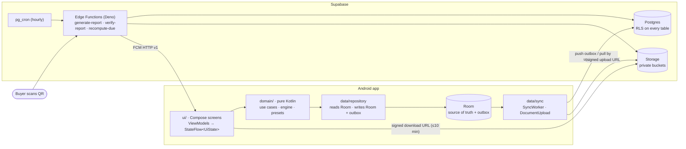

# KronoKeep

[](https://github.com/Adrian7373/KronoKeep/actions/workflows/ci.yml)

**A vault for the things you own.** Log a scooter, an aircon or a laptop once: receipt, serial number, warranty,
how much you ride. KronoKeep predicts when each maintenance task is due, keeps the service history, and when you
sell, it exports a **verified maintenance PDF** that a buyer can check by scanning its QR code.

Native Android (Kotlin, Jetpack Compose) on a Supabase backend. Built for the Philippines: km, ₱, `en-PH` dates.

> Portfolio project. The aim is a small app done properly: a pure, tested prediction engine shared by device
> and server, offline-first sync, private document storage and tamper-evident reports.

---

## Highlights

### 1. Predictive maintenance engine
Each task is due at **whichever comes first**: the calendar trigger (`last done + interval days`) or the usage
trigger (`(last done km + interval km − current km) / km per day`).

- **km/day is a time-decay EWMA** over odometer readings (30-day half-life), so the estimate follows how you ride
  *now*. With fewer than two readings it falls back to the weekly estimate ÷ 7.
- **It never fakes precision.** Every prediction carries a confidence (reading count, recency, rate variance)
  and a ± window. The UI draws that window as a band on a timeline: an exact calendar date is a dot, a noisy
  usage estimate is a wide band.
- **Pure and deterministic.** `domain/engine` takes `now` as a parameter and has no Android imports. The same
  engine is ported line for line to TypeScript for the server (`supabase/functions/_shared/engine.ts`).
  **Both pass the same JSON fixtures** (`engine-fixtures/`), whose expected values were worked out by hand.

### 2. Secure document storage
- Receipts and warranty cards go to a **private** bucket at `{user_id}/{asset_id}/{uuid}.{ext}`. Storage RLS
  checks the first path segment against `auth.uid()`.
- Uploads use signed upload URLs. Viewing uses **signed URLs that expire within 10 minutes**, fetched into memory
  with image caches off. `getPublicUrl` is never called.
- Images are compressed on the phone (longest side 2048 px, JPEG 85) and their SHA-256 is recorded.

### 3. Offline-first sync
- **Room is the source of truth.** Every write lands in Room plus an `outbox` row in **one transaction**, and the
  UI shows "Saved on phone" until it syncs.
- `SyncEngine` pushes parents first in batches, then pulls by keyset (`updated_at`, `id`) because one `now()`
  can stamp many rows. Conflicts resolve **last-write-wins** per row on the server-owned `updated_at`.
- Rejected rows are retried one by one and marked FAILED after 5 attempts. Outages go back to WorkManager with
  exponential backoff. Rows created before sign-in are claimed on the first sync.

### 4. Server-side verified PDF
- The `generate-report` Edge Function snapshots the asset and its service history into **canonical JSON**,
  hashes it with SHA-256 and renders an A4 PDF (`pdf-lib`) with the hash and a QR code.
- Generating a report **locks** the included service logs, and a database trigger enforces that lock.
  Finalising re-checks that nothing changed since the snapshot was read (`40001` if it did).
- Anyone can open `verify-report?id=…`, which answers **Valid / Revoked / Not found** and lists the entries so a
  buyer can compare them with the printout. Share links last 7 days, can be revoked, and only their hash is stored.

### Also
On-device receipt OCR and live serial or barcode scanning (ML Kit, models bundled). Odometer nudges. Daily local
reminders, plus FCM push from an hourly `pg_cron` job. Notification actions ("Mark done", "Log service").
Light and dark "Asset Tag" theme.

---

## Architecture

MVVM with unidirectional data flow, organised as clean-architecture packages inside one `:app` module.



| Layer | What lives there |
|---|---|
| `domain/` | Models, repository interfaces, use cases, `engine/`, `presets/`, `capture/` (receipt parser). No Android or Supabase imports. |
| `data/local/` | Room entities, DAOs, `KronoDatabase`, outbox. Schemas exported to `app/schemas/`. |
| `data/remote/` | supabase-kt DTOs and data sources. |
| `data/repository/` | Repository implementations: read Room, write Room + outbox in one transaction. |
| `data/sync/` | `SyncEngine`, `SyncWorker`, document upload queue. |
| `ui/` | Feature screens and ViewModels; `ui/theme` design tokens; `ui/components` shared composables. |
| `supabase/` | SQL migrations, Edge Functions, pgTAP RLS tests. |

**Data model** (Postgres is canonical, Room mirrors it): `assets`, `maintenance_schedules`, `service_logs`,
`odometer_readings`, `documents`, `reports`, `device_tokens`, `reminder_log`. IDs are client-generated UUIDs.
Synced tables soft-delete and carry a server-owned `updated_at`. Money is `Long` centavos, distance `Int` km.

## Tech stack

Kotlin · Jetpack Compose + Material 3 · Navigation 3 · Hilt · Room · DataStore · WorkManager ·
kotlinx.serialization · Coil 3 · supabase-kt (Ktor OkHttp) · CameraX · ML Kit (text, barcode) · Firebase Cloud Messaging.
Backend: Supabase Postgres + RLS, Auth, Storage, Edge Functions (TypeScript/Deno), `pg_cron`, `pdf-lib`.

## Testing

| Suite | Command | What it covers |
|---|---|---|
| JVM unit tests (280+) | `./gradlew :app:testDebugUnitTest` | Engine and shared fixtures, sync engine against a fake server (LWW, rejections, outages), repositories (transactions, rollback, locks), mappers, receipt parser, reminder planner, formatters |
| Compose UI tests | `./gradlew :app:connectedDebugAndroidTest` | Add-asset wizard (including receipt scan) and log-service flows |
| Server tests (52) | `node --test "supabase/functions/_shared/*.test.ts"` | TypeScript engine on the same fixtures, canonical JSON and hashing, report snapshot, verify/share rules, FCM |
| RLS tests (pgTAP) | `supabase test db` | User B can't read, write, re-parent or delete user A's rows or files; locked logs, server-only RPCs, anon access, and a guard that fails if any public table lacks RLS |
| Lint | `./gradlew :app:lintDebug` | Android lint |

CI (`.github/workflows/ci.yml`) runs lint, unit tests and `assembleDebug`, the Node tests, and the pgTAP suite
against a fresh local Supabase stack on every push.

## Running it

Requirements: Android Studio with JDK 17+ (the Gradle daemon uses JDK 25 via toolchains), Android SDK 37.

```bash
./gradlew :app:installDebug
```

Without any keys the app runs **offline only** and shows a "Cloud not configured" banner, so everything except
sync, documents in the cloud and reports works out of the box. To connect a Supabase project, add these to
`local.properties` (gitignored):

```properties
supabase.url=https://<project-ref>.supabase.co
supabase.publishableKey=<publishable key>
# Optional, for push reminders:
firebase.projectId=
firebase.applicationId=
firebase.apiKey=
firebase.gcmSenderId=
```

Backend setup (migrations, Edge Functions, cron secret, Vault entries) is in [`supabase/README.md`](supabase/README.md).
Service-role keys never go into the app; they live only in Edge Function secrets.

### Release APK

`./gradlew :app:assembleRelease` builds a whole-app R8-minified APK. It is signed when these keys are set in
`local.properties` (or as `KRONO_RELEASE_STOREFILE`, `KRONO_RELEASE_STOREPASSWORD`, `KRONO_RELEASE_KEYALIAS`,
`KRONO_RELEASE_KEYPASSWORD` environment variables); without them the release APK is left unsigned.

```properties
release.storeFile=/absolute/path/outside/the/repo/kronokeep-release.jks
release.storePassword=
release.keyAlias=kronokeep
release.keyPassword=
```

Create a keystore with `keytool -genkeypair -keystore kronokeep-release.jks -storetype PKCS12 -alias kronokeep
-keyalg RSA -keysize 4096 -validity 10000`, keep it out of the repo (`*.jks` is gitignored) and back it up: an
installed app can only be updated by an APK signed with the same key. The release build differs in signature
from debug builds, so uninstall a debug install before installing it.

## Screenshots

Coming with the demo build. Design direction and theme previews are in [`design/previews/`](design/previews/).

## Project status

Built in milestones (`feat/m1-…` to `feat/m8-…`). Progress, decisions and what's still unverified are tracked in
[`CLAUDE.md`](CLAUDE.md#phase-tracker). Deferred to v2: household sharing, configurable units, editing a service
log in place.

## Licences

Fonts: Schibsted Grotesk and IBM Plex Mono, both SIL Open Font License (`app/src/main/assets/licenses/`).
